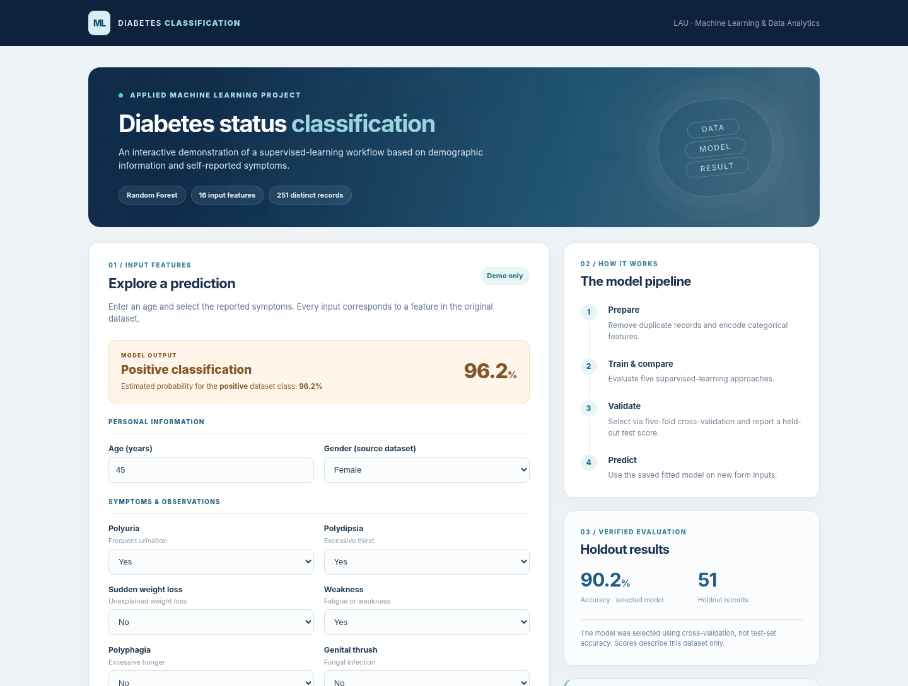
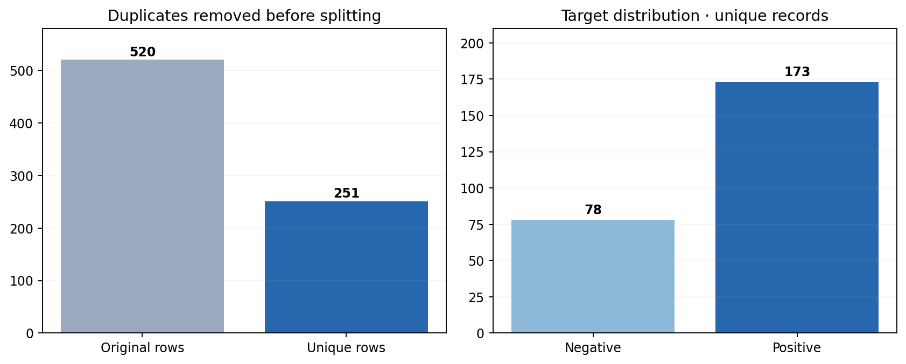
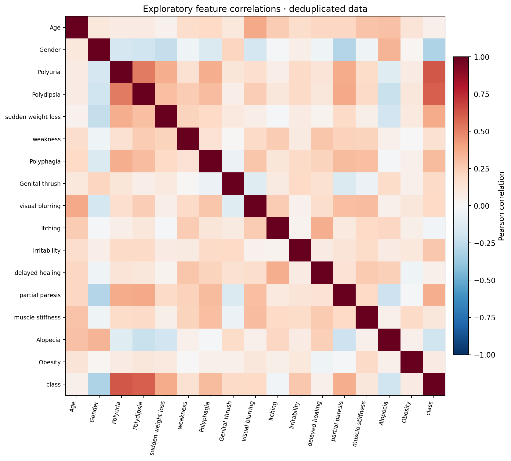
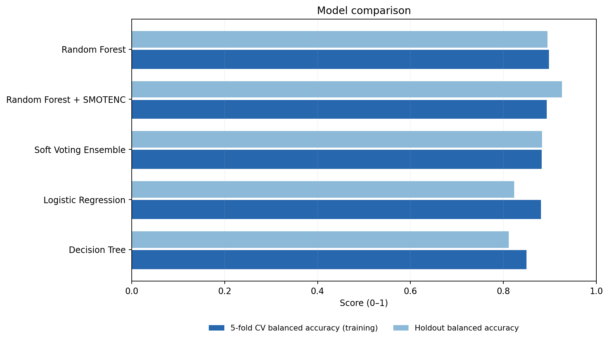
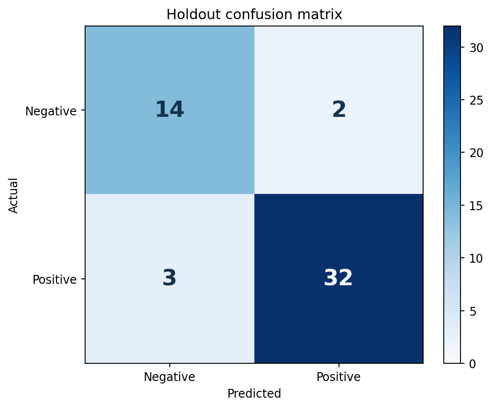
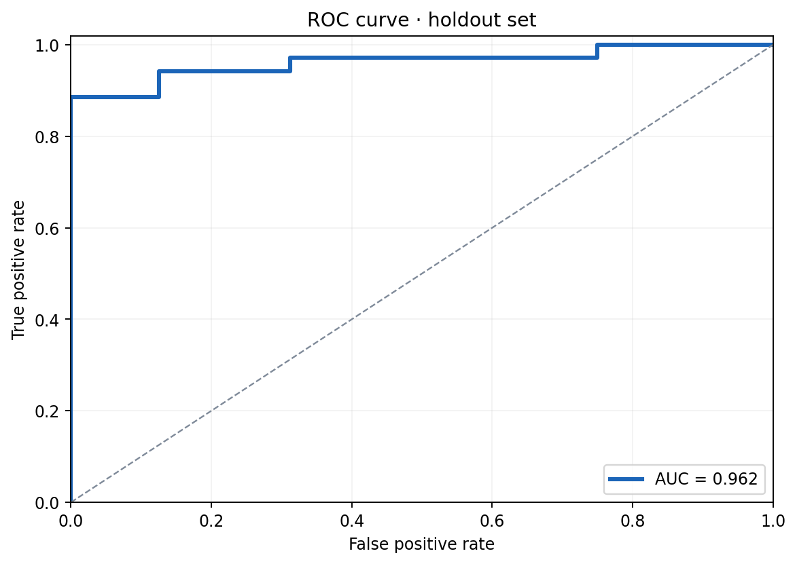
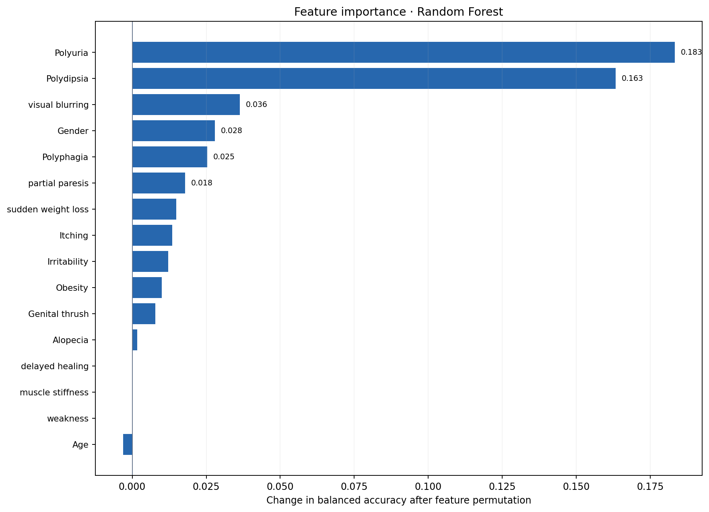
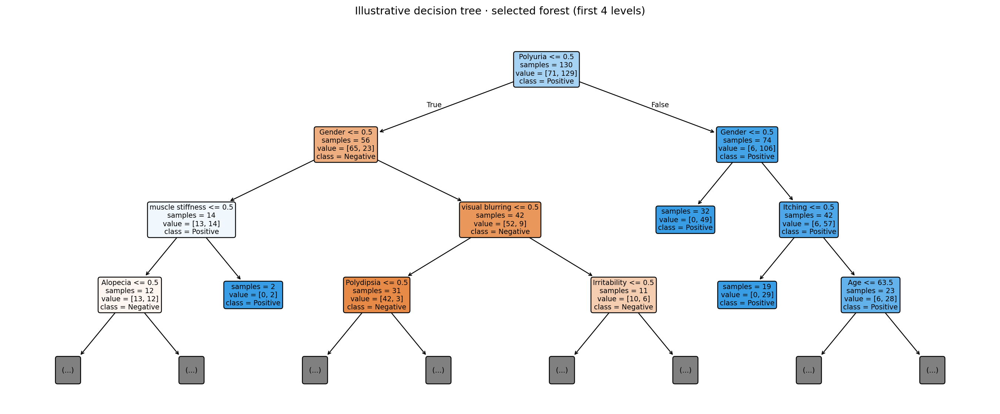
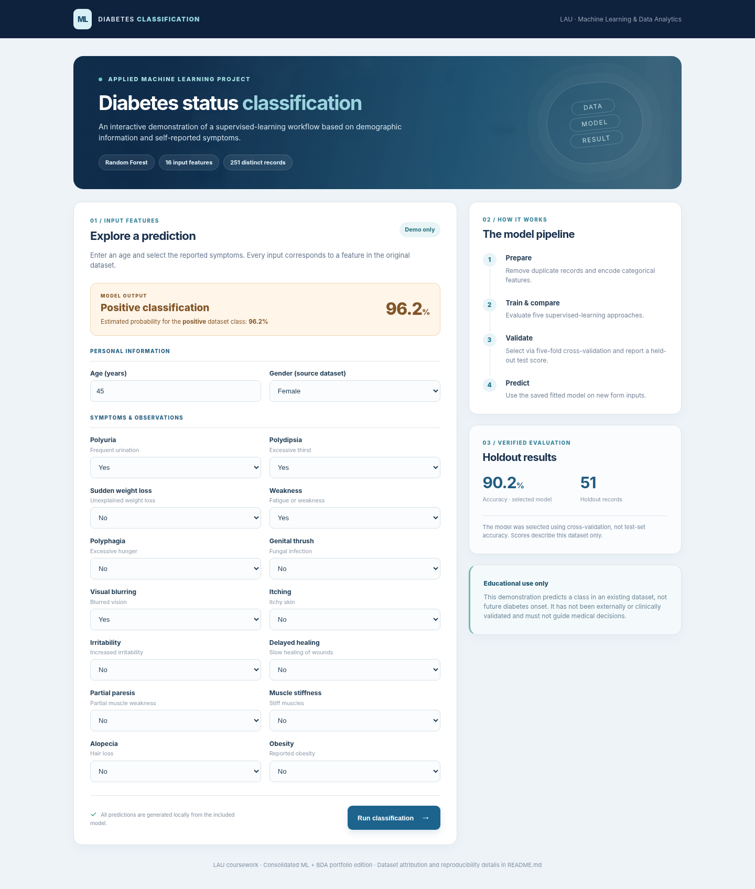

# Diabetes Classification | Machine Learning & Data Analytics

**An end-to-end machine learning project that analyzes patient symptoms and demographic information to classify diabetes status, compare five modeling approaches, and present predictions through an interactive web application.**

**Project area:** Machine Learning · Data Analytics · Supervised Classification · Model Evaluation  
**Technologies:** Python · pandas · scikit-learn · imbalanced-learn · Matplotlib · Flask  
**Academic context:** Lebanese American University (LAU) · Group coursework



## Project overview

The goal of this project is to build and evaluate a **binary classification system** using demographic and symptom-based data. Given information such as age, frequent urination, excessive thirst, and other reported symptoms, the system estimates whether a record belongs to the dataset's **Positive** or **Negative** diabetes class.

The work follows a complete data science workflow, from exploring and preparing raw data to training classifiers, comparing their performance, interpreting predictions, and providing a usable web interface.

**Five machine learning approaches were evaluated:** Logistic Regression, Decision Tree, Random Forest, a Soft Voting Ensemble, and Random Forest with SMOTENC oversampling.

## Project workflow

1. **Explore the dataset** — inspect feature types, missing values, class distribution, duplicates, and correlations.
2. **Prepare the data** — remove duplicate records, encode categorical variables, and build a stratified training/test split.
3. **Train five approaches** — compare linear, tree-based, ensemble, and class-balancing methods.
4. **Evaluate performance** — use stratified cross-validation and an untouched holdout set to measure generalization.
5. **Interpret results** — generate feature importance, confusion matrix, ROC curve, and other visualizations.
6. **Deploy a demonstration** — connect the selected trained classifier to a Flask web application.

## Dataset and preprocessing

The dataset includes **16 input features** and one binary target label. The inputs cover age, gender, and symptom indicators such as polyuria, polydipsia, sudden weight loss, weakness, visual blurring, and obesity.

| Dataset property | Value |
|---|---:|
| Original records | 520 |
| Exact duplicate records removed | 269 |
| Unique records used | 251 |
| Input features | 16 |
| Training records | 200 |
| Test records | 51 |
| Positive / Negative records | 173 / 78 |

Preprocessing checks for missing values and unexpected categories, removes **exact duplicates before the data split**, and encodes categorical features numerically. An **80/20 stratified split** preserves the class proportions across training and test sets.



### Exploratory data analysis

The project examines class imbalance and relationships among the variables using distribution plots and a correlation heatmap. These visualizations help identify useful patterns and understand the dataset before modeling.



## Machine learning models

The following five approaches were trained and compared:

| Approach | Purpose |
|---|---|
| **Logistic Regression** | Establish a linear classification baseline. |
| **Decision Tree** | Learn interpretable, rule-based decision boundaries. |
| **Random Forest** | Combine decision trees to capture nonlinear relationships. |
| **Soft Voting Ensemble** | Combine Logistic Regression, Decision Tree, and Random Forest probability estimates. |
| **Random Forest + SMOTENC** | Explore the effect of balancing the minority class using synthetic training samples. |

**Model evaluation:** Each approach is assessed using five-fold stratified cross-validation on the training set. Performance is measured with accuracy, balanced accuracy, precision, recall, F1-score, ROC–AUC, and a confusion matrix. The SMOTENC approach resamples **training data only**, including within cross-validation folds, to avoid leakage into evaluation data.

## Results and model comparison

| Model | CV balanced accuracy | Test accuracy | Test balanced accuracy |
|---|---:|---:|---:|
| Logistic Regression | 88.1% | 80.4% | 82.3% |
| Decision Tree | 85.0% | 76.5% | 81.2% |
| **Random Forest (selected)** | **89.8%** | **90.2%** | **89.5%** |
| Soft Voting Ensemble | 88.2% | 86.3% | 88.3% |
| Random Forest + SMOTENC | 89.4% | 92.2% | 92.6% |

**Random Forest was selected** because it achieved the highest average cross-validation balanced accuracy on the training data. On the held-out test set, it achieved:

- **90.2% accuracy**
- **92.8% positive-class F1-score**
- **96.3% ROC–AUC**

The SMOTENC experiment scored higher on this particular test split (**92.2% accuracy**) but had slightly lower training cross-validation balanced accuracy, so it was not selected as the final model.



### Classification performance

| Confusion matrix | ROC curve |
|---|---|
|  |  |

### Feature importance and model interpretation

Permutation feature importance helps explore which input variables contribute most to the trained model's predictive performance. A sample decision-tree visualization is also included to illustrate tree-based decision rules.





## Interactive Flask application

The Flask web app provides a form where users can enter an age, select a gender, and answer symptom-based Yes/No questions. The application then:

- Validates the entered information.
- Applies the same feature representation used during training.
- Runs the selected Random Forest model.
- Displays the predicted **Positive** or **Negative** class and the model's estimated positive-class probability.



## Run locally

**Requirements:** Python 3.10 or newer.

**1. Install dependencies**

Windows (PowerShell):

```powershell
py -m venv .venv
.venv\Scripts\Activate.ps1
pip install -r requirements.txt
```

macOS / Linux:

```bash
python3 -m venv .venv
source .venv/bin/activate
pip install -r requirements.txt
```

**2. Run the tests and reproduce the training results (optional)**

```bash
python tests.py
python train.py
```

The repository already includes a fitted model, evaluation figures, and an executed notebook. Running `train.py` regenerates the model and figures for your installed environment.

**3. Launch the web app**

```bash
python app.py
```

Open **http://127.0.0.1:5000** in your browser.

**4. Explore the notebook (optional)**

```bash
jupyter notebook notebooks/Consolidated_Diabetes_Classification.ipynb
```

## Repository structure

```text
Diabetes-Classification-ML/
├── README.md
├── ACKNOWLEDGMENTS.md
├── app.py                        # Flask application
├── train.py                      # Model training and evaluation
├── tests.py                      # Basic checks
├── requirements.txt
├── data/                         # Dataset
├── src/                          # Preprocessing, models, inference
├── models/                       # Fitted classifier and evaluation results
├── notebooks/                    # Executed analysis notebook
├── templates/                    # Web application HTML
├── static/                       # Styles and assets
├── docs/images/                  # Screenshots and analysis figures
└── archive/                       # Original coursework reference files
```

## Credits and notes

Developed as group coursework at **Lebanese American University**. Original contributors, academic context, and data attribution are documented in [ACKNOWLEDGMENTS.md](ACKNOWLEDGMENTS.md).

**Dataset:** [Diabetes Risk Prediction — Kaggle](https://www.kaggle.com/datasets/rcratos/diabetes-risk-prediction/data).

**Scope:** The dataset describes diabetes status rather than future onset. This is an educational classification demonstration, not a clinically validated diagnostic or screening tool. Results are based on a small holdout set and should not be used for medical decisions.
